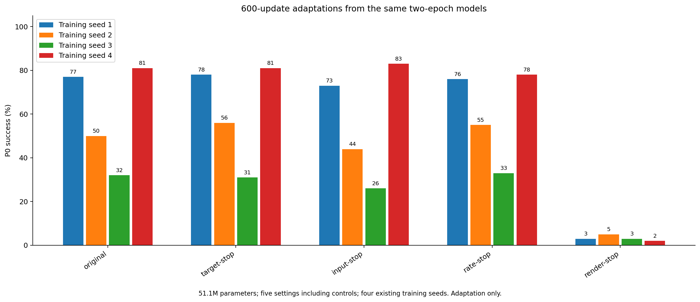
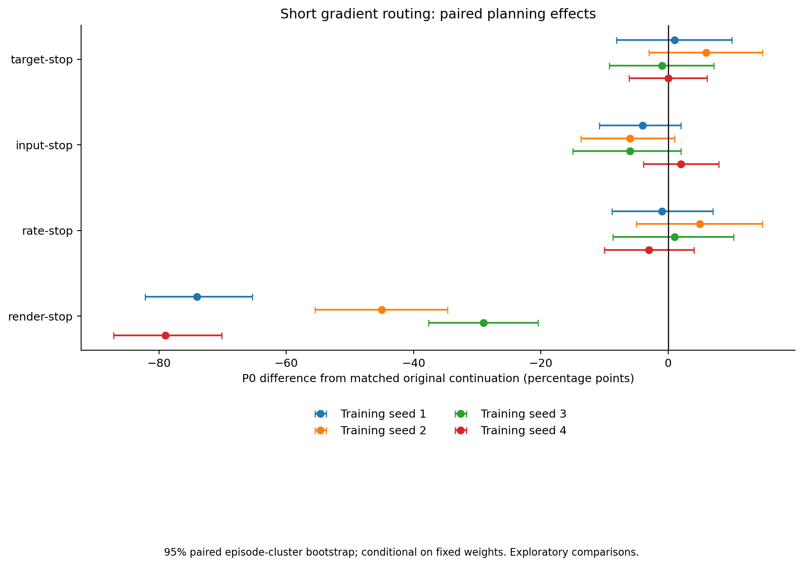

# Sample-level梯度路由：600更新配对适应筛选

全部方法从同一训练种子对应的原算法2epoch完整状态出发，只适应600更新。模型参数固定51,097,134，batch128，beta=.25，sigma=.1，学习率日程124910步。

这不是从头训练稳定性，也不是划时代或新颖性的证明。包含原算法续训及必要对照，未修正多重比较；后续胜者必须独立确认。

| 方法 | 训练种子 | P0均值 % | 相对原算法续训百分点 | h7 agent/copy ↓ | h7 moving block/copy ↓ | 动作识别 % | 训练秒数 |
| --- | ---: | ---: | ---: | ---: | ---: | ---: | ---: |
| original | 1 | 77.0 | +0.0 | 0.186 | 0.268 | 82.81 | 632.7 |
| original | 2 | 50.0 | +0.0 | 0.296 | 0.324 | 87.50 | 650.4 |
| original | 3 | 32.0 | +0.0 | 0.422 | 0.354 | 64.06 | 627.7 |
| original | 4 | 81.0 | +0.0 | 0.167 | 0.239 | 84.38 | 629.2 |
| target-stop | 1 | 78.0 | +1.0 | 0.215 | 0.251 | 82.81 | 622.5 |
| target-stop | 2 | 56.0 | +6.0 | 0.276 | 0.391 | 87.50 | 620.6 |
| target-stop | 3 | 31.0 | -1.0 | 0.418 | 0.348 | 65.62 | 625.2 |
| target-stop | 4 | 81.0 | +0.0 | 0.164 | 0.247 | 84.38 | 640.3 |
| input-stop | 1 | 73.0 | -4.0 | 0.192 | 0.264 | 82.81 | 615.6 |
| input-stop | 2 | 44.0 | -6.0 | 0.312 | 0.329 | 87.50 | 621.1 |
| input-stop | 3 | 26.0 | -6.0 | 0.413 | 0.351 | 59.38 | 613.6 |
| input-stop | 4 | 83.0 | +2.0 | 0.167 | 0.232 | 84.38 | 611.8 |
| rate-stop | 1 | 76.0 | -1.0 | 0.215 | 0.259 | 81.25 | 617.2 |
| rate-stop | 2 | 55.0 | +5.0 | 0.277 | 0.387 | 84.38 | 632.2 |
| rate-stop | 3 | 33.0 | +1.0 | 0.400 | 0.367 | 65.62 | 607.0 |
| rate-stop | 4 | 78.0 | -3.0 | 0.172 | 0.255 | 84.38 | 613.9 |
| render-stop | 1 | 3.0 | -74.0 | 1.125 | 1.581 | 25.00 | 628.7 |
| render-stop | 2 | 5.0 | -45.0 | 0.966 | 1.173 | 21.88 | 602.2 |
| render-stop | 3 | 3.0 | -29.0 | 1.041 | 1.446 | 29.69 | 592.0 |
| render-stop | 4 | 2.0 | -79.0 | 0.944 | 1.349 | 25.00 | 624.9 |

[完整逐例结果、配对episodebootstrap、检查点身份与成本](routing-short-results.json)、[生成逐例数值](routing-short-per-case.npz)。

所有新运行均已停在600更新上限。根据两种子的规划/生成/动作结果及成本作继续决定，不自动延长整组。

## 配对效果与下一步

[全部四种子数值、机制证据与停止依据](DECISION.md)。renderer-stop四种子均发生控制性能退化，同时仍通过粗略后验坍塌判据。所有新适应已停止在600更新。
