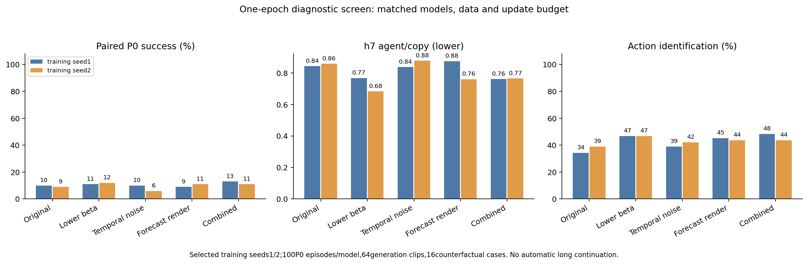

# 一epoch短线筛选

全部模型固定为51,097,134参数、全数据、batch128；从可恢复状态补到12491更新，保留124910步学习率日程。原算法直接使用已保存的同预算checkpoint。

seed1/2是有意选择的诊断种子，本表不是正式多种子benchmark。旧16运行均已暂停，短线结果不会自动触发长跑。

| 方法 | 训练种子 | P0原评测42/43 % | 均值 % | h7 agent/copy ↓ | h7 moving block/copy ↓ | 动作识别 % | block动作识别 % |
| --- | ---: | --- | ---: | ---: | ---: | ---: | ---: |
| original | 1 | 8 / 12 | 10.0 | 0.843 | 0.532 | 34.38 | 39.06 |
| original | 2 | 12 / 6 | 9.0 | 0.859 | 0.606 | 39.06 | 40.62 |
| lower-beta | 1 | 16 / 6 | 11.0 | 0.768 | 0.428 | 46.88 | 43.75 |
| lower-beta | 2 | 10 / 14 | 12.0 | 0.683 | 0.434 | 46.88 | 39.06 |
| temporal-noise | 1 | 8 / 12 | 10.0 | 0.838 | 0.520 | 39.06 | 46.88 |
| temporal-noise | 2 | 6 / 6 | 6.0 | 0.878 | 0.415 | 42.19 | 34.38 |
| forecast-render | 1 | 14 / 4 | 9.0 | 0.876 | 0.789 | 45.31 | 42.19 |
| forecast-render | 2 | 14 / 8 | 11.0 | 0.761 | 0.790 | 43.75 | 42.19 |
| temporal-forecast | 1 | 10 / 16 | 13.0 | 0.762 | 0.507 | 48.44 | 43.75 |
| temporal-forecast | 2 | 18 / 4 | 11.0 | 0.765 | 0.430 | 43.75 | 42.19 |

规划起点、目标及动作反事实案例已逐例匹配。完整逐例规划/反事实/生成数值及运行身份见[JSON](short-screen-results.json)和[数值NPZ](short-screen-per-case.npz)。FVD64只作为诊断，不宣称完整生成质量。

继续/暂缓决定须结合两种子的任务差异、生成和动作信号另行记录。早期较弱不构成方法普遍失败的证明。
