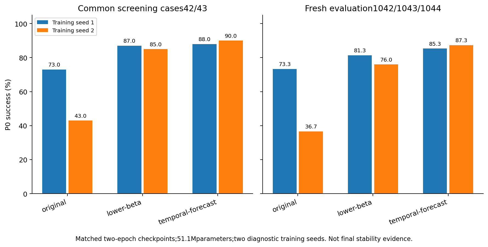

# Selected two-epoch arms: matched task evidence

Allparent16jobs andsupplement36jobs completed0. Four selected training runs stopped exactly24982updates. Same51.1Mparameters and124910stepLRhorizon; beta/noise/forecast variants remainexplicit.

| Method | Training seed | PrimaryP0% | FreshP0% | h7agent/copy | h7movingblock/copy | ActionCF% |
| --- | ---: | ---: | ---: | ---: | ---: | ---: |
| original | 1 | 73.0 | 73.33 | 0.185 | 0.318 | 81.25 |
| original | 2 | 43.0 | 36.67 | 0.376 | 0.341 | 81.25 |
| lower-beta | 1 | 87.0 | 81.33 | 0.117 | 0.244 | 81.25 |
| lower-beta | 2 | 85.0 | 76.00 | 0.125 | 0.204 | 82.81 |
| temporal-forecast | 1 | 88.0 | 85.33 | 0.120 | 0.254 | 82.81 |
| temporal-forecast | 2 | 90.0 | 87.33 | 0.119 | 0.304 | 79.69 |

Fullnumeric/per-case/conditionaluncertainty:stage2-results.json andstage2-per-case.npz. Selected diagnostic seeds, not stable89%or from-scratch confirmation. No automatic continuation.

[中文结论、直接调参比较与继续依据](DECISION.md)。Temporal-forecast在两个诊断训练种子的同预算比较中优于β=.25原版；更多种子/第三epoch/组件控制待验证。
