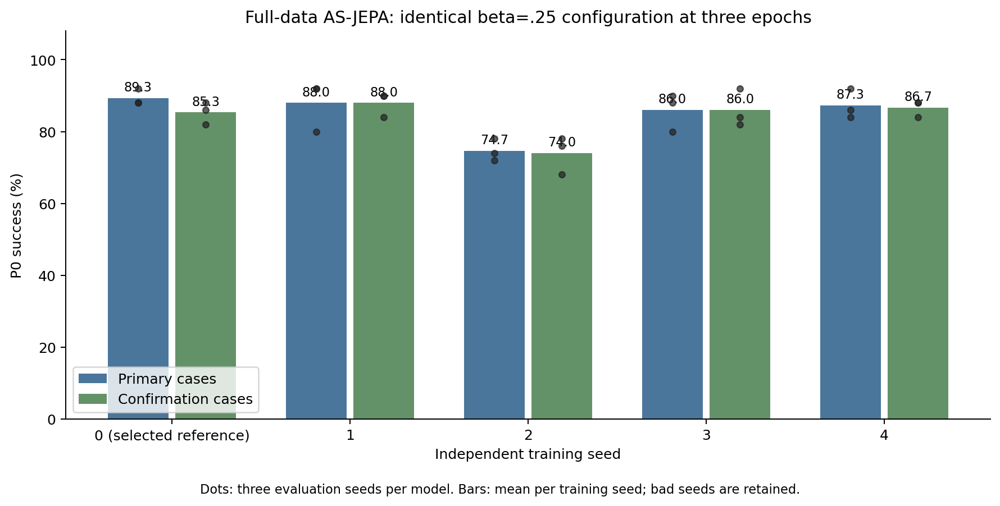
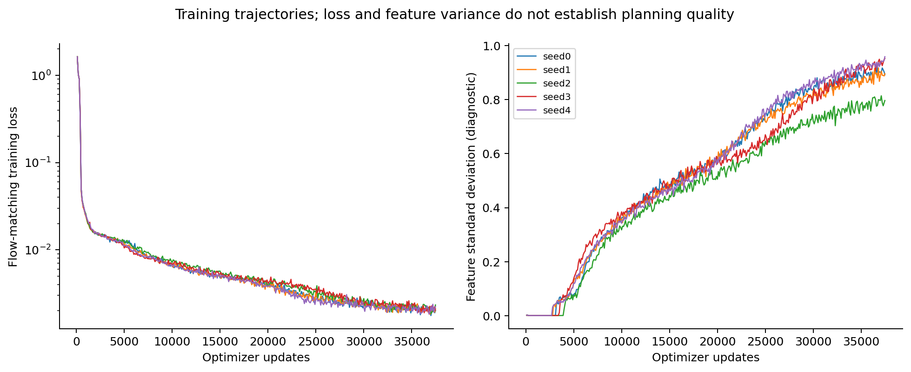

# 全数据 beta=.25：独立训练种子复现

固定模型、数据、batch128、sigma=.1和优化器；每个种子训练37473步，保留原124910步学习率日程。只改变训练随机种子和输出目录。

seed0是历史选出的参考；新增seed1–4单独统计，不能把评测种子当作训练种子。

| 训练种子 | 原评测42/43/44 % | 均值 % | 新评测1042/1043/1044 % | 均值 % |
| --- | --- | ---: | --- | ---: |
| 0 | 92 / 88 / 88 | 89.33 | 82 / 88 / 86 | 85.33 |
| 1 | 92 / 92 / 80 | 88.00 | 84 / 90 / 90 | 88.00 |
| 2 | 74 / 78 / 72 | 74.67 | 68 / 78 / 76 | 74.00 |
| 3 | 88 / 90 / 80 | 86.00 | 84 / 92 / 82 | 86.00 |
| 4 | 84 / 92 / 86 | 87.33 | 84 / 88 / 88 | 86.67 |

| 统计对象 | 原评测：跨训练种子均值 ± SD % | 最差训练种子 % | 新评测：均值 ± SD % | 最差训练种子 % |
| --- | ---: | ---: | ---: | ---: |
| 新增seed1–4 | 84.00 ± 6.28 | 74.67 | 83.67 ± 6.50 | 74.00 |
| 全部seed0–4 | 85.07 ± 5.94 | 74.67 | 84.00 ± 5.68 | 74.00 |

预先声明的主要实用稳定性检查：未全部通过。
需结合新评测及含噪后验检查解释；有限种子样本不构成形式化总体保证。

[完整逐例规划、训练曲线、身份与统计](full-data-stability.json)。这仍是三epoch中期结果，未声称完成原始完整benchmark。

## 生成与含噪后验检查

全部五个训练种子都通过含噪后验坍塌判据，均有64个活跃维度。非空状态与高规划成功率仍是不同标准。

| 训练种子 | h7 agent/copy ↓ | h7 moving block/copy ↓ | 动作识别 % | block动作识别 % | 后验/anchor误差 ↓ |
| --- | ---: | ---: | ---: | ---: | ---: |
| 0 | 0.134 | 0.189 | 89.84 | 72.66 | 0.051 |
| 1 | 0.131 | 0.209 | 88.28 | 71.48 | 0.052 |
| 2 | 0.193 | 0.241 | 82.81 | 62.89 | 0.057 |
| 3 | 0.116 | 0.243 | 88.67 | 67.97 | 0.059 |
| 4 | 0.119 | 0.223 | 86.33 | 74.61 | 0.051 |

新增seed1–4原评测P0为88.00/74.67/86.00/87.33%，均值84.00±6.28%；新评测为88.00/74.00/86.00/86.67%，均值83.67±6.50%。历史选出seed0与新增种子分开报告。完整五种子均值85.07%并不等于稳定复现89.33%。

较低分seed2同时有较弱的agent/block线性可解码性，但这只是诊断关联，不能据此证明失败原因。后续同规模对照将分别测试降低beta、时间相关后验噪声、预测状态渲染训练及其组合。

[完整probe](full-data-stability-probes.json)、[逐例生成数值](full-data-stability-per-case.npz)、[生成汇总](full-data-stability-quality-summary.json)、[验证记录](full-data-stability-validation.json)。人工gallery签收尚未发生。
