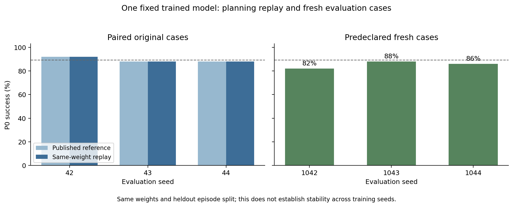

# 固定 seed0 checkpoint：规划复跑与新案例

本记录不是多训练种子复现结果。seed1–4 的独立训练仍在进行。

同一份权重，在原 P0 评测种子42/43/44上的已发布结果为 [92.0, 88.0, 88.0]%，本次复跑为 [92.0, 88.0, 88.0]%，均值 89.33%。
150个起点/目标案例身份完全一致，逐例成功/失败结果全部相同：True。
预先声明的新评测种子1042/1043/1044为 [82.0, 88.0, 86.0]%，均值 **85.33%**。
新旧各150个案例的完全相同reset数量为 1；它们仍来自同一heldout episode split，不能称为新数据集。

这支持原checkpoint的规划结果可以复跑、且在新案例上仍有较高成功率；它不能回答换训练初始化后是否稳定。

[完整逐例数值与验证身份](seed0-reevaluation.json)。所有六次新评测均exit0，权重与原checkpoint为同一物理文件。
