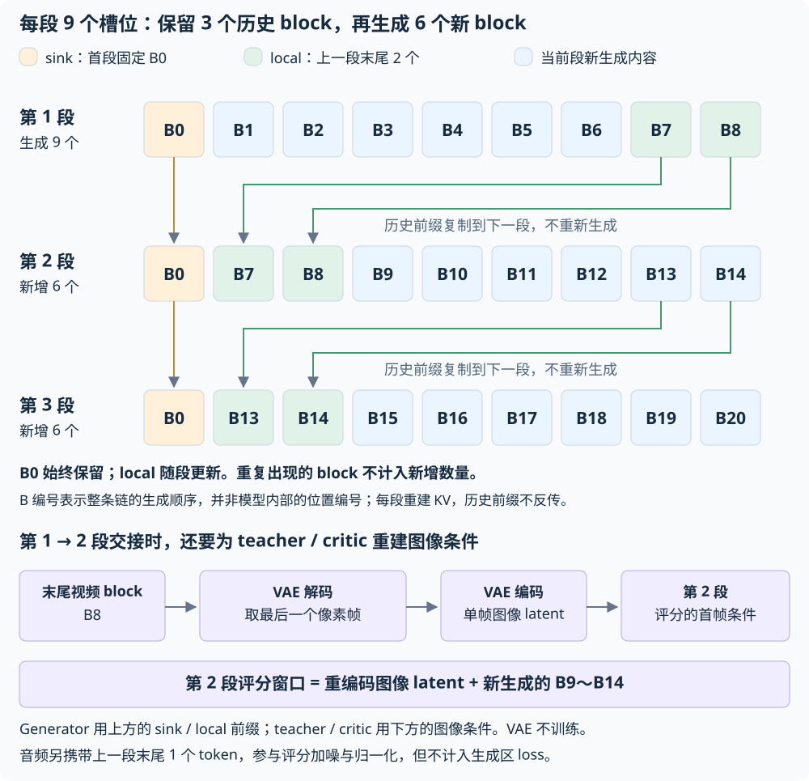
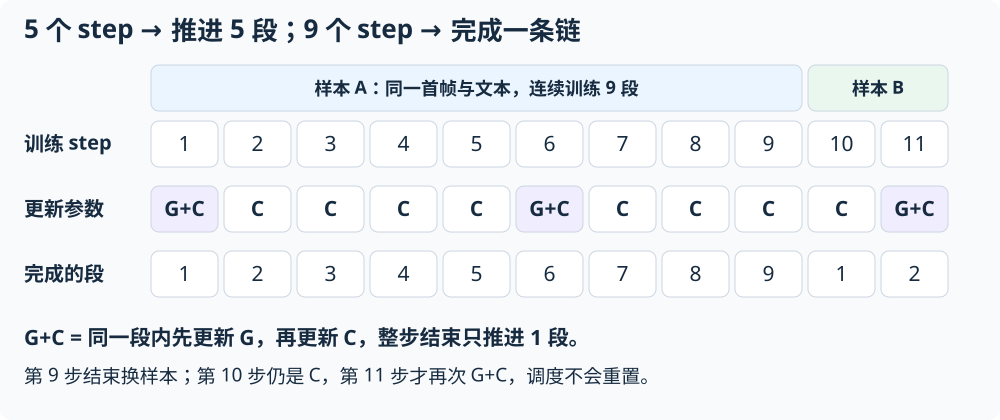

# LTX2.3 Long Tuning

Long Tuning 用于在已有 DMD student 上继续训练**多段连续生成**，让模型学习利用之前
生成的内容续写视频。它沿用 DMD 的蒸馏目标和 G/C 更新方式，主要改变生成上下文和样本的使用方式。

## 与 DMD 的区别

- **初始权重**：普通 DMD 从 causal TF generator 开始蒸馏；Long Tuning 从已训练的
  DMD student 继续训练。teacher / critic 默认从官方 BASE 初始化，也可指定独立 score 权重。
- **一条样本训练多段**：普通 DMD 的每次 rollout 独立生成一个片段；Long Tuning 每个
  训练步推进一段，整条链结束后才换样本。默认一条链包含 9 段，因此会连续使用同一条样本
  9 步。缓存只需提供首帧、文本、分辨率和帧率，生成总长度由段参数控制。
- **生成时保留前文**：后续段携带首段的固定 block（sink）和上一段末尾的 block（local），
  再生成新内容。跨段 latent 不传递梯度，每段重建 KV；无需保留整条长视频的计算图。
- **评分前重建首帧条件**：上一段末尾 block 经视频 VAE 解码，取最后一个像素帧，再编码为
  下一段的图像 latent。teacher / critic 使用这个图像条件和新生成内容评分；generator
  使用上面的 sink / local 前缀。这是 Long Tuning 额外需要视频 VAE 的原因，VAE 本身不训练。
- **恢复时保留生成进度**：除模型、优化器和随机状态外，checkpoint 还保存当前样本、
  段序号和段间 latent，重启后接着当前链训练。

从 DMD 切换时，使用 `experiment=ltx23_long_tuning`，换成 DMD student 权重，
并按目标生成长度设置下面的段参数。学习率和 G/C 更新频率沿用
[DMD 配置](dmd.md#dmd-learning-rate)。

## 准备模型与数据

准备官方 BASE checkpoint、已训练的 DMD student、Gemma 和与
[DMD 相同格式的数据缓存](dmd.md#dmd-data)。生成时长不受缓存视频时长限制。

默认 teacher 和 critic 从 BASE 的 Transformer 权重初始化。已有独立的 score 权重时，
设置 `training.models.real_score.init_weights=/path/to/score.safetensors`，critic 同步使用
该文件。BASE 还提供文本处理和段间视频 VAE 的权重。

`ieg-infra-efs` 挂载为 `/efs` 时，可使用下面的范例路径；替换为自己的权重和缓存即可
训练其他数据。

```bash
export LTX_BASE=/efs/alexlshen/vforge/examples/ltx23-dmd/model/base.safetensors
export LTX_STUDENT=/efs/alexlshen/vforge/examples/ltx23-long-tuning/model/generator.safetensors
export LTX_GEMMA=/efs/alexlshen/vforge/examples/ltx23-dmd/model/gemma-3-12b
export LTX_CACHE=/efs/alexlshen/vforge/examples/ltx23-long-tuning/cache
```

## 设置生成长度与训练步数 {#_1}

### 设置每条样本的生成长度 {#_2}

默认每条样本训练 9 段，共生成 57 个 block，按默认布局、24 FPS 计算约为 57 秒。
通过以下参数设置生成长度，不受缓存视频原始时长限制：

```yaml
training:
  dmd:
    chain:
      segment_slots: 9       # 每段容纳的 block 数，包括历史前缀
      max_rollout_blocks: 57 # 一条样本的目标生成 block 总数
      sink_blocks: 1        # 固定保留首段的第一个 block
      local_blocks: 2       # 保留上一段末尾两个 block
```

使用默认配置时，首段生成 9 个 block。后续每段复用 3 个历史 block，再生成 6 个新 block，
因此总长度为 `9 + 8 × 6 = 57` 个 block。下图展示前三段的衔接方式；重复出现的历史
block 不计入新增数量。



需要生成更长的视频时，可保留每段长度与前缀设置，在启动命令中增加：

```bash
training.dmd.chain.max_rollout_blocks=105
```

生成长度按完整段计算，实际长度可能略超出目标。段间衔接自动完成，无需额外准备逐段首帧数据。

### 设置训练步数 {#step}

通过 `runtime.max_steps` 设置整个任务的训练步数，默认是 2000。**每步训练一段**：
默认一条样本占用 9 步，完成后才换样本。例如，从头运行 18 步会完成两条段链
（每个 DP rank 各处理两条样本）：

```bash
runtime.max_steps=18
```

下图按从 1 开始的训练步序号展示参数更新与段号的对应关系：



默认 generator 每 5 步更新一次，critic 每步更新，即 `G+C, C, C, C, C`。
这五步推进五段，更新频率按全局步数连续计算，不随样本切换而重置。

只更新 critic 的步骤也会用当前 generator 生成新内容，随后用这次结果衔接下一段。
G+C 步骤先生成并更新 generator，再用更新后的 generator 重新生成内容训练 critic；
两次生成共用当前段的旧前缀，最后选用第一次生成的结果衔接下一段，仍只推进一段。

段内默认使用 `block_replay` 降低显存占用。学习率及其他 DMD 通用选项见
[DMD 训练指南](dmd.md#dmd-learning-rate)。

## 启动训练

下面使用单机 8 卡运行 DP4 × USP2；纯 DP8 训练时，将 `parallel.usp_size` 改为 `1`。
学习率和 G/C 更新频率沿用 [DMD 学习率配置](dmd.md#dmd-learning-rate)。

```bash
torchrun --standalone --nproc-per-node=8 -m vforge.tasks.train \
  experiment=ltx23_long_tuning \
  training.models.generator.pretrained_path="$LTX_BASE" \
  training.models.generator.init_weights="$LTX_STUDENT" \
  training.models.generator.config.text_encoder_path="$LTX_GEMMA" \
  data.sources.0.cache_dir="$LTX_CACHE" \
  parallel.usp_size=2 \
  attention.backend=auto \
  runtime.output_dir=/efs/your-name/ltx-long-tuning \
  checkpoint.every_n_steps=100 \
  resume.path=auto
```

## 保存与恢复

上面的命令每 100 步保存一次完整 checkpoint，训练结束时也会保存。默认保存在
`${runtime.output_dir}/checkpoints`；设置了 `checkpoint.dirpath` 时，使用指定目录。

`resume.path=auto` 会在该目录查找最新完整 checkpoint：

- **第一次训练**：没有 checkpoint 时，从 `LTX_STUDENT` 初始化 generator，开始新的段链。
- **中断后继续训练**：使用原输出目录重新启动，恢复模型、优化器、随机状态、当前样本及
  段间 latent，从 checkpoint 记录的已完成段之后继续。

`LTX_STUDENT` 是初始模型权重，不包含完整训练进度。完整续训使用 vForge 保存的
checkpoint，并保持相同的并行拓扑、段配置和 BASE 资产；新开一轮训练时换一个输出目录。
指定 checkpoint 及远端存储的用法见[保存、恢复与自动容错](../../guide/training-recovery.md)。

## 推理

训练后的 checkpoint 可直接用于 [DMD 推理](eval.md)，支持缓存文本或自定义 prompt，
输出带音轨的视频。
