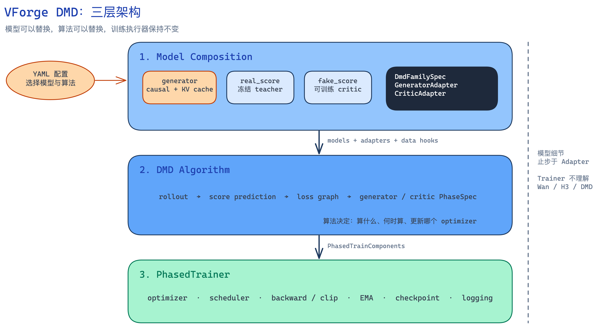
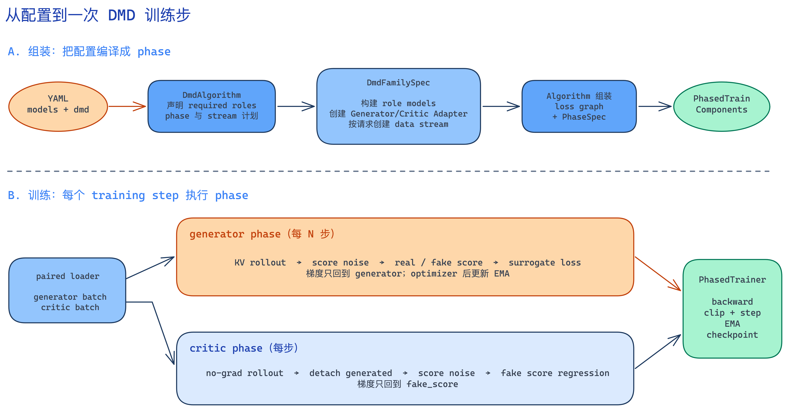
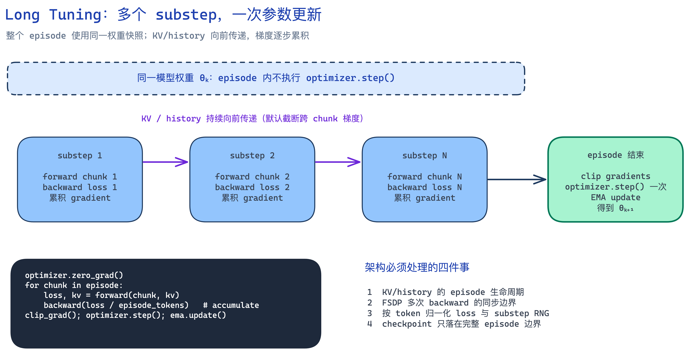

# VForge DMD 目标架构

## 一句话说明

DMD 是一种**多模型训练方式**，不是一个模型名称。VForge 将它拆成三层：

1. **Model Composition**：决定使用哪些模型；
2. **DMD Algorithm**：决定如何 rollout、计算 loss 和安排训练 phase；
3. **PhasedTrainer**：负责真正执行训练。

这样新增模型时不用重写 DMD 算法，修改算法时也不用改 Trainer。



## 三层分别负责什么

### 1. Model Composition

`training.models` 显式声明算法需要的模型角色。标准 Distribution Matching 使用：

- `generator`：生成蒸馏样本，必须支持 causal forward 和 KV cache；
- `real_score`：冻结的 teacher，提供真实分布的 score；
- `fake_score`：可训练 critic，拟合 generator 分布。

模型家族只注册一个 `DmdFamilySpec`，提供 role models、Generator/Critic
Adapter 和 phase 数据流。每个 role 直接从独立的模型原生 checkpoint 初始化，不提供
DMD 专用 checkpoint 映射。Adapter 隔离模型差异：Generator
Adapter 负责带 KV cache 的分块 rollout，Critic Adapter 负责 score forward。

### 2. DMD Algorithm

`training.dmd.algorithm` 选择算法。算法声明所需模型角色，调用 Adapter，定义
rollout、loss、`PhaseSpec`、执行频率、optimizer 目标和 EMA 时机。

模型 family 不创建 phase，Trainer 也不理解 DMD 数学。

### 3. PhasedTrainer

`PhasedTrainer` 接收 `PhasedTrainComponents`，按 `PhaseSpec` 执行 forward、
backward、optimizer、scheduler、EMA、checkpoint 和日志。

因此 Trainer 不依赖 Wan、H3、KV cache 或某一种 DMD loss。

代码目录与三层边界对应：

- `vforge/algorithms/dmd/`：Model Composition、Adapter 和 DMD Algorithm；
- `vforge/tasks/<model>/dmd/`：模型家族提供的 Adapter 与组装 hooks；
- `vforge/tasks/dmd/`：仅保留 train recipe 入口；
- `vforge/data/multi_stream_loader.py`：通用、可恢复的命名多流加载；
- `vforge/training/phased_trainer.py`：phase 编排和训练生命周期。

## 如何组装和训练



组装顺序是：

```text
YAML 选择模型与算法
→ DistributionMatchingAlgorithm 声明需要的 roles
→ DmdFamilySpec 构建 role models、Adapters 和 data support
→ DistributionMatchingAlgorithm 生成 loss graph 与 PhaseSpec
→ PhasedTrainer 执行
```

`DmdFamilySpec.validate` 在模型分配前完成静态检查。算法声明 phase 使用的
stream 和 seed-offset，模型 family 使用已有 data builder 创建数据流，runtime
将它们组成 paired loader。

模型 family 同时接受普通 latent cache 和 raw data：offline 直接读取模型已有
cache schema，online 调用模型已有 encoder。DMD 不定义独立 encode 命令或 cache
格式；两条路径只在进入 `PreparedDmdBatch` 前不同。

一次 training step 中：

- **generator phase**：KV rollout → real/fake score → surrogate loss；
  只更新 generator，随后更新 EMA；
- **critic phase**：no-grad rollout → detach → fake-score regression；
  只更新 fake-score；
- generator 可以每 N 步执行一次，critic 可以每步执行。

### 数值规则的边界

Wan 使用 `distribution_matching`：rollout 和 score noise 消耗进程全局随机数，
critic loss 使用经过 `x0` 舍入后转换回来的 velocity，sigma 保持原精度参与加噪。
`StepContext.random_streams` 将这套全局 RNG 随 checkpoint 一起保存和恢复，
Wan 不另建按 phase 分隔的命名流，也不按 optimizer step 重新播种。
LTX 使用 `block_distribution_matching`：按用途命名、持续推进的随机数流、
直接 velocity 回归、显式 FP32 加噪，以及 retained-graph / block-replay 两种反向方式。
Wan 的规则由 `tasks/wan_taichu/dmd/algorithm.py` 和 `runtime.py` 实现，继承公共
`DistributionMatchingAlgorithm`，复用阶段、优化器和 EMA 的装配。家族声明的
`algorithm_type` 让训练入口选用该实现，用户配置仍为 `distribution_matching`。
Wan 的退出时间步、上下文轨迹和精度转换不改变公共 runtime、loss helper 或 LTX 的
默认行为。Wan 在 task 中覆盖 `critic_step`，完成自身的预测转换；公共 critic 流程
继续直接读取 adapter 的 velocity。A14B checkpoint 的 expert key 选择也由 Wan task
提供，复用已有权重 factory 接口。CPU contract 可以检查这些规则，真实 GPU 数值仍需对应模型的 GPU
gate 验证。

Trainer 在训练启动时按 `runtime.seed` 初始化全局 RNG。旧 `performance` 模式依赖
进入 Trainer 前的随机数状态，旧 `fixed-rng` / `strict` 模式则会按 step 重设种子；
这些历史序列不与当前训练逐位兼容。Wan DMD 在相同起始 RNG 状态下保留原有的
采样顺序与数值规则；确定性计算统一使用 `runtime.deterministic`，不恢复旧执行模式。

## 新增模型或算法

### 新增模型

新增模型家族时，只注册一个 DMD 入口：

```python
MY_MODEL_DMD = DmdFamilySpec(
    model_name="my_model",
    validate=validate_my_model_dmd,
    build_role_model=build_my_model_role,
    build_data_support=build_my_model_data,
    create_generator_adapter=create_generator_adapter,
    create_critic_adapter=create_critic_adapter,
)
```

role model、data/encode 和 checkpoint loader 应复用模型已有能力。DMD 只补充两类
Adapter，以及少量 validation/data hooks：

1. **Generator Adapter**
   - 创建一次 rollout 使用的 KV cache 和 RoPE context；
   - 将 latent 按模型规则切成有序 block；
   - 对当前 block 执行 causal forward，并把完成的 block 写入 KV history；
   - 将所有 block 还原成统一的 `LatentBundle`。
2. **Critic Adapter**
   - 把统一的 noisy latent、timestep 和 conditional/unconditional conditioning
     转成 score model 的输入；
   - 执行 bidirectional score forward；
   - 将模型输出还原成算法使用的统一 velocity。
3. **Data/noise hooks**
   - 将 encoded batch 转成 `PreparedDmdBatch`；
   - 将归一化 noise level 转成模型 timestep 和 sigma；
   - 提供 anchor、padding 和 loss-valid mask。
4. **Validation hook**
   - 在分配模型前检查 role、variant、并行和数据约束。

每个 `training.models.<role>.init_weights` 都是该模型可独立加载的扁平 state dict。
训练恢复统一使用 full DCP，不解析包含 `generator`/`critic` section 的联合 checkpoint。

Generator/Critic Adapter 应复用模型已有的 KV/RoPE 和 raw model forward；
从统一 latent/timestep 到模型 tensor layout 的转换留在 Adapter。inference 的
scheduler、CFG、`no_grad` 和 decode loop 不进入 Adapter。

不需要重写 rollout 主循环、loss 或 Trainer。H3 使用同一入口，首期三个 role
属于同一模型家族。

### 新增算法

当模型角色、计算顺序、loss graph 或 optimizer phase 发生变化时，新增一个
`Algorithm`：

```python
class MyAlgorithm(Algorithm[DmdModelFamily]):
    name = "my_dmd"
    required_roles = frozenset({"generator", "teacher", "critic"})
    role_capabilities = {
        "generator": "generator",
        "teacher": "critic",
        "critic": "critic",
    }
    frozen_roles = frozenset({"teacher"})

    def validate_request(self, request, *, engine, integration):
        ...

    def build_components(self, request, *, integration):
        # 调用 integration 提供的 models / adapters / data
        # 定义 loss，并创建 PhaseSpec
        return PhasedTrainComponents(...)


register_algorithm(MyAlgorithm)
```

- `required_roles` 声明算法需要哪些模型；
- `role_capabilities` 声明每个 role 需要 Generator 还是 Critic Adapter；
- `frozen_roles` 声明只参与前向、不进行 optimizer update 的 role；
- `validate_request()` 在分配模型前检查算法配置和模型能力；
- `build_components()` 定义计算流程、loss、phase 顺序、执行频率和 optimizer 目标；
- 返回的 `PhasedTrainComponents` 交给同一个 `PhasedTrainer`。

只调整 loss 权重或执行频率时修改 YAML；模型 tensor layout 变化时修改 Adapter，
都不需要新增算法。

## YAML 配置

配置分工只有三条：

- `training.models`：模型组成；
- `training.dmd`：算法与 phase 规则；
- `optimizers`：各 phase 使用的 optimizer。

```yaml
training:
  recipe: dmd
  models:
    generator:
      model: wan_taichu
      config:
        variant: wan22_ti2v_5b_causal_teacher
        frame_per_block: 3
        first_frame_own_block: true
      pretrained_path: /path/to/wan-config
      init_weights: /path/to/generator.pt

    real_score:
      model: wan_taichu
      config:
        variant: wan22_ti2v_5b
      pretrained_path: /path/to/wan-config
      init_weights: /path/to/teacher.pt

    fake_score:
      model: wan_taichu
      config:
        variant: wan22_ti2v_5b
      pretrained_path: /path/to/wan-config
      init_weights: /path/to/critic.pt

  dmd:
    algorithm: distribution_matching
    rollout:
      denoising_steps: [1000, 938, 833, 625, 0]
      terminal_zero_is_boundary: true
      last_step_only: true
    score:
      num_train_timesteps: 1000
      timestep_shift: 5.0
      sampled_timestep_min: 1
      effective_timestep_clamp: [20, 980]
      real_guidance_scale: 5.0
    schedule:
      generator_every_n_steps: 5
    ema:
      enabled: true
      decay: 0.99
      start_step: 200
      storage: sharded_fp32

optimizers:
  generator:
    name: adamw
    learning_rate: 2.0e-6
  critic:
    name: adamw
    learning_rate: 4.0e-7
```

`frame_per_block` 等字段属于 generator 模型配置，不属于 DMD 算法。

训练中使用 `checkpoint.state=full`、`checkpoint.format=dcp` 保存完整恢复状态。
最终发布物不是三塔 DCP，而是从中剥离出的 generator，通常选择 EMA：

```bash
python -m vforge.tasks.convert_checkpoint \
  convert_checkpoint.input_path=/path/to/step.dcp \
  convert_checkpoint.output_path=/path/to/generator.pt \
  convert_checkpoint.component_path=generator \
  convert_checkpoint.weights=ema
```

## Long Tuning 扩展

Long Tuning 先支持一个场景：多个连续 substep 累积梯度，episode 结束时只更新
一次参数。



所有 substep 使用同一权重；KV/history 持续传递；每个 substep 独立
forward/backward；episode 末尾统一 clip、optimizer step 和 EMA。默认截断跨
chunk 梯度，只传递 KV/history 的数值状态。

Trainer 需要支持一次 optimizer transaction 内多次 backward，并处理 FSDP
同步、loss 归一化、RNG 和 checkpoint 边界；substep 编排仍属于算法层。

## 设计边界

- 目标支持 Wan 和同模型家族 H3；
- generator 必须支持 causal forward 与 KV cache；
- cross-family 模型组合需要额外解决 latent、noise/timestep、conditioning 和
  gradient 的表示兼容，本设计暂不定义该转换接口；
- Megatron 和跨 optimizer step 的 KV/history 复用不在当前目标内。
