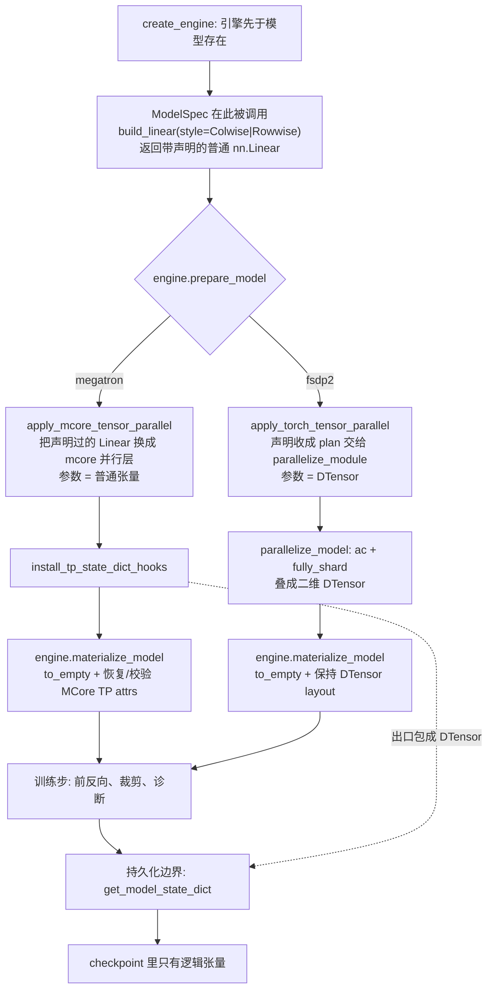

# 训练引擎：FSDP2 与 Megatron 的共存契约

这份文档回答一个反复出现的问题：**同一套框架里放两个引擎，什么能共用、什么必须分叉、按什么标准判断。**

用户侧能力与选择见[分布式运行](../features/distributed-training.md)。

!!! note "阅读前提"
    先读[架构与所有权](architecture.md)中的模型生命周期，再用用户侧
    [分布式运行](../features/distributed-training.md)确认公开组合。本文只解释 FSDP2
    与 Megatron 在构造、分片、optimizer 和 checkpoint 生命周期中的实现分叉。

## 按读者与任务查阅

- 配置并行组合：看用户侧[分布式运行](../features/distributed-training.md)，无需先读内部实现；
- 给模型增加 TP：只需实现三类模型接口——
  [`build_linear` + `ParallelStyle`](#tp-build-linear)、
  [`local_heads`](#tp-local-heads)、
  [group-aware norm](#tp-group-aware-norm)；
- 维护现有 engine：先核对[不变的原则](#engine-invariants)和
  [应用顺序](#application-order)；
- 新增 engine：从 [`TrainingEngine` ABC](#training-engine-abc) 和
  [机制的三档处理](#mechanism-routing)开始；
- 修改 checkpoint：转到
  [Checkpoint 与 S3 内部机制](checkpoint-internals.md)，不要从模型 TP 声明推导存储协议。

## `TrainingEngine` ABC {#training-engine-abc}

接口真源是
[`vforge/training/engine/base.py`](https://git.woa.com/ieg-infra/wmtrain/blob/master/vforge/training/engine/base.py)。
一个 engine 必须实现五个方法：

- **`prepare_model`**：在 optimizer 构造前施加 engine 所属的模型并行化；
- **`materialize_model`**：在分片布局确定后分配参数存储，并重建后端所需 metadata；
- **`prepare_data_parallel`**：在 materialize 和预训练权重加载后施加复制式数据并行；
- **`configure_optimizers`**：构造 engine-owned optimizer/scheduler；不接管时返回 `None`，
  由 recipe fallback；
- **`run_step`**：执行一个不可拆分的 optimizer step，包括 forward、backward 和 update。

模型作者不需要实现这个 ABC；模型只声明 TP 语义，engine 负责兑现。

### 训练随机状态

Trainer 在训练开始时使用 `TrainerConfig.seed`（来自 `runtime.seed`）播种全局 RNG。`StepContext.random_streams` 持有整次训练共享的
命名 generator，task 通过
`context.random_streams.generator("noise", seed=seed, device=device)` 获取。
首次调用创建并播种，后续返回同一个 generator；同名流的 seed 和 device 在一次训练中固定。
需要隔离的随机输入（如长度与噪声）使用不同名字。processor 接收 generator，
只有课程调度、专家交替等更新语义读取 step，不再用 step 重建随机输入。

`RandomStreams.state_dict()` 统一快照这些 generator 和全局 RNG，
`load_state_dict()` 统一恢复；CheckpointManager 直接使用这两个接口。恢复顺序见
[Trainer resume 状态机](checkpoint-internals.md#trainer-resume-state-machine)。
`runtime.deterministic` 通过 `OpsConfig` 交给共享 runtime，在 `initialize_ops()`
中统一设置 PyTorch、cuDNN 和 FA4 确定性，不在 Trainer 中重复执行。TF32 不受
该字段控制。随机状态恢复的验证范围见
[Checkpoint 内部机制](checkpoint-internals.md#trainer-resume-state-machine)。

写下来是因为这个判断每加一个并行维度（cp、pp）、每碰一个机制（checkpoint、梯度裁剪、optimizer）都要重来一遍，而每次重来都会漏掉同样几件事。张量并行（tp）是目前唯一两侧都摸过的维度，所以拿它打样：下面每条规则都能在 tp 上指出具体落点。

两个引擎不是"同一件事的两种实现"。它们有两个根本分歧：**分片后的参数是什么类型**，以及**复制式 DP 的梯度存在哪里**。前者会一路传导到 checkpoint、权重加载和逻辑归约；后者决定 backward、裁剪与 optimizer step 的生命周期。

## 不变的原则 {#engine-invariants}

这些是已经确认、后续改动不应推翻的约定。

- **引擎每进程选一次，不回退。** 选了 megatron 就不会中途切回 fsdp；引擎不可用时报错而不是降级——降级会让任何跨引擎的数值比较失去意义。见 [vforge/training/engine/__init__.py](https://git.woa.com/ieg-infra/wmtrain/blob/master/vforge/training/engine/__init__.py)。
- **`ParallelState` 是所有通信域的唯一主人，且只描述拓扑。** 它不知道、也不该知道选了哪个引擎。mcore 只接收注入的 `tp_group`，`initialize_model_parallel` 永不调用——否则同一批 rank 上会出现两个生命周期各管一半的通信域。
- **模型只声明，引擎才实现。** 模型说"这个投影按列切"，不说由谁去切。声明用的是 PyTorch 自己的 `ParallelStyle`（`ColwiseParallel` / `RowwiseParallel`），`build_linear` 返回的是一个带着这个声明的普通 `nn.Linear`——**无论 `tp_size` 是多少都不切**。两个引擎在 `prepare_model` 里各自把声明兑现成分片。
- **引擎选择先于模型解析。** Native recipe 可交出 `ModelSpec` 或已有 `nn.Module`；
  新模型优先使用前者。Trainer 先执行 `create_engine`，再由 `session.setup()` 解析
  `ModelSpec`，最后交给 `engine.prepare_model()`。tp 本身不依赖延迟构造，但未来
  流水线并行需要按 stage 构造；同时也避免非法的“引擎 + 拓扑”组合先白建一个大模型。
- **所有并行维度为 1 时，megatron 引擎必须与 fsdp2 逐位一致。** 开启复制式 DP 后，Megatron 使用 MCore DDP 而 torch-native 路径使用 PyTorch DDP；两者的逻辑梯度必须一致，但不同 collective 实现不承诺 bitwise 一致。
- **checkpoint 存逻辑张量，不存布局。** 两个引擎存出来的东西可以互读，而 HF 预训练权重加载也就退化成 fsdp2 早已解决的那个问题。反过来若各存各的分片布局，就等于承认"换引擎要重训"。
- **mcore 的参数在 step 内保持普通张量，只在持久化边界变成 DTensor。** 不能图省事让它一直是 DTensor：mcore 的层直接对 `self.weight` 做 matmul，DTensor 会去推导分片传播，可能静默插入错误的通信。
- **materialize 是 engine contract。** `Trainer` 只编排 `engine.materialize_model()`；fsdp2 保持 DTensor layout 后分配存储，megatron 则在 `to_empty()` 后立即从模块声明重建并校验 MCore TP parameter metadata。DDP 不修复 materialize 的副作用。

## 两者的真实差异

- **切分时机。** mcore 是构造期换类型，`ColumnParallelLinear` 必须在 `__init__` 里就位，因为它的参数形状本来就是本地分片。torch native 是建完之后整树改造：`parallelize_module(model, tp_mesh, plan)`，plan 按模块的全限定名匹配。
- **参数表示。** torch native 产出 **DTensor**，自带 mesh 与 placement；mcore 产出**普通张量**。这是根，下面几条都是它的推论。
- **梯度表示。** PyTorch DDP/FSDP 把归约后的梯度留在 `Parameter.grad`；MCore DDP 把它放在连续 buffer，并由 `Parameter.main_grad` 指向对应 view。vForge 的通用梯度 accessor 按参数实际携带的表示取值，不按 engine 字符串分支。
- **通信域来源。** torch native 吃 mesh 的某一维；mcore 吃一个显式的 `ProcessGroup`，我们把 vforge mesh 的 `tp_group` 注进去。
- **能不能和 fsdp2 叠。** torch native 能，mcore 不能。`fully_shard` 会把参数换成数据 mesh 上的 DTensor——即使那个 mesh 只有一个 rank、什么都没切——所以它盖住的若是 mcore 的普通分片，state_dict 就只描述数据轴。两个 DTensor 轴则会叠成 `(dp_shard_usp, tp)` 二维 placement，逻辑形状仍是完整的。mesh 里两维本来正交，见 [vforge/distributed/parallel_state.py](https://git.woa.com/ieg-infra/wmtrain/blob/master/vforge/distributed/parallel_state.py) 的维度顺序与 `fsdp_mesh`。
- **HSDP 如何表达。** `dp_replicate_size > 1` 时，torch-native FSDP2 接收
  `("dp_replicate", "dp_shard_usp")` 二维 mesh：外层在 shard group 间复制，
  内层对参数分片。所有 leaf、precision boundary 和 root 的 `fully_shard` 调用
  使用同一个 mesh。该能力不接入 Megatron/MCore FSDP。
- **optimizer state。** torch native 免费拿到：`get_state_dict` 从参数推导 optimizer 条目，参数是 DTensor，条目也就带上 tp 轴。mcore 拿不到，因为参数在 step 内必须是普通张量。
- **谁负责归约。** DTensor 自己知道该怎么 all-reduce；普通张量必须手写 tp 感知的归约，漏写不会报错，只会算错。
- **一个容易踩的事实。** `to_empty()` 会**抹掉**挂在参数上的属性（mcore 的 `tensor_model_parallel` 之类）。所以"这个参数是否被切、沿哪一维切"必须记在**模块**上而不是张量上——模块身份能活过 materialize。

### mcore 能表达 torch 的哪些 layout

不是"只支持默认值"，而是逐条对得上。每个 style 有一个可变的轴和一个固定的轴，可变的那个 mcore 有构造参数，固定的那个是它无条件的行为：

| torch style | mcore |
| --- | --- |
| `ColwiseParallel.input_layouts` 恒为 `Replicate()` | 输入恒走 identity 前向 / all-reduce 反向 |
| `ColwiseParallel.output_layouts` = `Shard(-1)` 或 `Replicate()` | `gather_output=False` / `True` |
| `RowwiseParallel.input_layouts` = `Shard(-1)` 或 `Replicate()` | `input_is_parallel=True` / `False` |
| `RowwiseParallel.output_layouts` 恒为 `Replicate()` | forward 结尾 all-reduce；bias 在其**之后**加，这是行并行 bias 不能切的原因 |

两样对不上，理由不同：`use_local_output=False` 要求返回 DTensor，mcore 里没有这个概念，**永远**不行；序列维的 `Shard(1)` mcore **能**做，但走 `config.sequence_parallel` 而不是构造参数，所以它是全局开关不是逐层声明。这两样在声明处就 fail-fast，见 `_validate_style`。

## 应用顺序，以及为什么 {#application-order}

一个模型上要落好几种并行，顺序是硬约束而不是习惯。当前顺序，以及各自在哪：

```text
tp    engine.prepare_model()          各引擎自己的 apply_*_tensor_parallel
ac    parallelize_model()             cfg.gradient_checkpointing
fsdp  parallelize_model()             _apply_fsdp2，自底向上，根最后
mat   engine.materialize_model()      分配 shard；完成后端参数表示的 postcondition
load  Trainer                         materialize 后加载预训练基线
ddp   engine.prepare_data_parallel()  包 dp_cp_group，且早于 optimizer 构造
```

**tp 必须在 fsdp 之前**，因为运行时的顺序正好是反的：一步开始时 FSDP 在最外层 all-gather，TP 在里面算。所以"应用"必须反过来——TP 先落到模块上，FSDP 再包在外面。`fully_shard` 的行为是在参数**已有的** placement 上再加自己那一维；参数是普通张量时它只产出自己那一维，tp 轴就此静默消失。

**ac 也必须在 tp 之后。** torchtitan 有实测：反过来会在反向之后炸出 `got mixed torch.Tensor and DTensor`。我们这里 ac 和 fsdp 都在 `parallelize_model` 里、而 tp 在它之前，所以顺序天然成立。

### FSDP 多阶段更新的梯度归约 {#fsdp-phase-gradient-reduction}

多模型算法可以用整个模型容器作为 forward root，只对某个角色执行 optimizer update。
`LogicalReduction` 在并行包装完成后记录参与归约的参数身份，同一份记录用于各阶段的
梯度范数、裁剪和诊断；子模型的名称前缀变化不影响参数身份。

不要在阶段开始时从 `update_target.parameters()` 重建这份记录。无梯度 rollout
可能让 FSDP 根模块保持完整参数视图，而 backward 后恢复的是 optimizer 持有的分片
参数。此时重建会记录临时视图，随后漏算部分梯度，低估范数并可能造成裁剪不足。
`update_target` 仍决定本次检查和裁剪哪些参数，容器级记录只决定哪些物理副本参与
全局归约。

### MCore DDP 生命周期（模型作者可跳过） {#mcore-ddp-lifecycle}

**DDP 必须在 materialize 和预训练权重加载之后、optimizer 构造之前。** meta 参数不能交给 DDP；而 optimizer 必须持有最终包装后模型的参数。Megatron 引擎把 vForge 创建的 `dp_cp_group` 注入 MCore DDP，不能使用默认 world group：同一个 TP coordinate 在不同 DP replica/CP shard 上才拥有同形状、同语义的参数。默认 world group 会把不同 TP shard 混在一起。

MCore DDP 的梯度不留在 `Parameter.grad`，而是归入连续 buffer，并通过 `Parameter.main_grad` 暴露 view。MCore distributed optimizer 再将 buffer reduce-scatter 到各 DP×CP rank 的 FP32 optimizer shard。因此 step 顺序固定为：`optimizer.zero_grad` → `zero_grad_buffer` → backward hook 按 bucket 发起异步 reduce-scatter → `finish_grad_sync` 等待剩余通信 → `prepare_grads` → 逻辑 norm/clipping → optimizer shard update。更新后的参数不在 step 尾同步收集，而由下一次 forward 的 pre-hook 按 bucket all-gather，使后续 bucket 的通信与当前 bucket 的 forward 重叠。只有 parity 诊断要立刻遍历完整更新后模型，因此在诊断路径强制完成全部参数收集。有效性也要在 `dp_cp_group` 内取并集；否则某参数只在部分 rank 参与计算时，其他 rank 会把零 buffer 当成梯度，错误触发 weight decay 或动量更新。

同样的顺序在 torchtitan 是 `CP → TP → AC → compile → FSDP`，写在每个模型家族自己的 `parallelize.py` 里；理由见 [pytorch/torchtitan#1554](https://github.com/pytorch/torchtitan/issues/1554)。我们把它放在引擎里而不是模型旁边，因为他们只有一个后端，而"该做哪种 tp"这个知识在我们这儿必须由知道后端的一方持有。

## 机制的三档处理 {#mechanism-routing}

判断一个机制该怎么办，先问它是否触碰参数的表示。不碰的共用，碰但只在边界碰的做适配，全程都碰的分叉。

**直接共用：** 拓扑（`ParallelState`）、数据路径（`batch_group` 与 leader broadcast）、Trainer 循环、reporting、ops。

这些只关心"哪些 rank 构成一组"，不关心参数长什么样。`batch_group` 是个好例子：需要看到同一个 batch 的那组卡，在 fsdp 下是 usp 组、在 megatron 下是 tp 组，因为两者都复制 batch 而不是切分它——一个属性就把两个引擎的差异吸收掉了，数据路径本身不必分叉。

**边界适配：** 模型权重的读与写。

在引擎给模块装的 state_dict hook 上做转换，把 mcore 的本地分片包成 `DTensor.from_local(t, tp_mesh, [Shard(dim)])`，让 `get_model_state_dict` 看到逻辑完整的张量，load 时反向拆掉——或者把一个整块张量按本 rank 切一刀。转换放在引擎侧，[vforge/training/checkpoint/storage.py](https://git.woa.com/ieg-infra/wmtrain/blob/master/vforge/training/checkpoint/storage.py) 和 [vforge/models/loading.py](https://git.woa.com/ieg-infra/wmtrain/blob/master/vforge/models/loading.py) 都不需要知道 mcore 存在。

一份声明同时管住三条路，因为它们问的是同一个问题：HF safetensors 是整块的，DCP 按名字记录逻辑张量，PT 导出要把各片 gather 回去。见 [vforge/distributed/tensor_parallel.py](https://git.woa.com/ieg-infra/wmtrain/blob/master/vforge/distributed/tensor_parallel.py) 的 `install_tp_state_dict_hooks`。

**这层收不住的是 optimizer state。** MCore DistributedOptimizer 把 FP32 master weight 和 Adam moment 切在 DP×CP 轴上，TP-sharded 参数还同时拥有 TP 轴；这些不是模型 state_dict hook 能声明的张量。通用 torch optimizer state-dict 路径也不知道 MCore 的 shard range，因此当前在 [vforge/training/trainer.py](https://git.woa.com/ieg-infra/wmtrain/blob/master/vforge/training/trainer.py) fail-fast，后续由单独的 Torch DCP adapter 描述。

**必须分叉：** 模型构造后端、梯度裁剪与诊断的归约、optimizer、pp 调度。

这些全程都在碰参数表示，没有边界可以收口。注意梯度裁剪和诊断不会因为 checkpoint 做了 DTensor 转换而顺带被修好——step 内参数仍是普通张量，它们各自要做 tp 归约。

## 怎么写一个支持 TP 的模型 {#model-tp-interfaces}

三条，全在模型的 `__init__` 里，两个后端通用。不需要写 plan，不需要知道引擎，不碰 mesh。

### `build_linear` + `ParallelStyle` {#tp-build-linear}

投影用 `build_linear` 代替 `nn.Linear`，并用 `ParallelStyle` 声明它按哪个方向切。尺寸永远填**完整**的模型尺寸，后端自己除以组大小。

```python
from torch.distributed.tensor.parallel import ColwiseParallel, RowwiseParallel

self.to_q = build_linear(dim, self.inner_dim, bias=True, style=ColwiseParallel())
self.to_out = nn.ModuleList([build_linear(self.inner_dim, dim, bias=True, style=RowwiseParallel())])
```

词汇是 PyTorch 自己的 `ParallelStyle`，不是我们发明的。各家的拼法几乎一致——torch 是这两个类，mcore 是 `ColumnParallelLinear` / `RowParallelLinear`，transformers 是字符串 `"colwise"` / `"rowwise"`——所以没有第三种拼法要学。用裸的 style 就行：`use_local_output` 默认为 `True`，正是模型需要的（下一步要把投影 reshape 成 head，中间不能有 DTensor）。

判据只有一条：**产出**某个特征维的投影是 colwise，**消费**它的是 rowwise。注意力里 q/k/v 是 colwise、输出投影是 rowwise；MLP 里 up 是 colwise、down 是 rowwise。不变量是一个 colwise 之后必须先经过一个 rowwise，张量才能重新以完整宽度被使用——中间那段每个 rank 只持有自己那几列。

### `local_heads` {#tp-local-heads}

凡是把投影 reshape 成 head 的地方，head 数用 `local_heads(n)`。列切给这个 rank 的是投影的一段，恰好是整数个 head，所以 reshape 必须用本地数而不是配置里的数。

### Group-aware norm {#tp-group-aware-norm}

凡是在被切开的那个轴上做归一化的地方，用组感知的 norm。Wan 的 `qk_norm="rms_norm_across_heads"` 正是这种情况：它跨所有 head 一起算均方根，而那个轴就是被切的轴。本地算不是近似，是另一个函数。用 `local_rms_norm(local_width)`，它在 `tp_size == 1` 时就是 `nn.RMSNorm`。

`tp_size == 1` 时这三个调用返回的东西与未并行的模型逐位相同，所以"tp 关掉时不变"是构造出来的性质，不需要测试去追。

只有这两个 style 被接受，而且只接受两个后端都能兑现的 layout；`_validate_style` 在**声明处**就拒绝其余的，包括单卡运行——那种从不做任何转换的运行，否则一个不支持的声明能活到第一次多卡、甚至只在换引擎时才暴露。可用与不可用的完整清单见上面「mcore 能表达 torch 的哪些 layout」。

### 为什么是标记而不是手写 plan

`parallelize_module` 的 plan 按**全限定名**（FQN，子模块在模型树里的完整点分路径，也就是 `named_modules()` 给出的名字）匹配。主流写法是在模型旁边手写一份：

```python
parallelize_module(
    model,
    tp_mesh,
    {
        "blocks.0.attn1.to_q": ColwiseParallel(),
        "blocks.0.attn1.to_out.0": RowwiseParallel(),
    },
)
```

我们没这么做，两个原因。

其一，**mcore 用不了 plan**。它的层必须在构造期就是并行层，所以 `build_linear(shard=...)` 那个声明无论如何都得存在；再手写一份 plan 就是同一个事实的第二份副本，而没有任何东西保证两份一致。标记让声明只有一处。

其二，**plan 是从树上导出的，不是照着树写的**。手写 plan 里把 `to_q` 改名，plan 就静默不再匹配；导出的 plan 不可能不匹配。

标记要存在还有一个绕不开的理由：**模块在 `__init__` 里不知道自己叫什么**。名字是父模块执行 `self.to_q = ...` 那一刻才赋予的，子模块被构造时尚未挂到树上。所以只能先在模块上记一笔，等整棵树建完、FQN 第一次可知时由引擎去收。

代价是 `apply_torch_tensor_parallel` 里多一趟 `named_modules()` 遍历，以及一个 plan 描述不了的分支：不是 `Linear`、而是模型自己按本地宽度建出来的参数（Wan 的 q/k norm），没有现成 `ParallelStyle` 能说"这个参数就是一片"，要用 `DTensor.from_local` 直接声明。漏掉它不会报错——`fully_shard` 之后它会变成只在数据 mesh 上分片、逻辑宽度报成本地宽度的 DTensor，两个 tp rank 同名同形状。

### 通用件与模型件的边界

- [vforge/distributed/tensor_parallel.py](https://git.woa.com/ieg-infra/wmtrain/blob/master/vforge/distributed/tensor_parallel.py)：`build_linear`、后端上下文、两个后端各自的改造（`apply_torch_tensor_parallel` 与 `install_tp_state_dict_hooks`）、`ShardedRMSNorm`、mcore 胶水（`ModelParallelConfig` 的构造、把 `(output, bias)` 收成张量的两个子类）。一个切分过的线性层，谁来要都是同一个东西。
- [vforge/models/wan/tensor_parallel.py](https://git.woa.com/ieg-infra/wmtrain/blob/master/vforge/models/wan/tensor_parallel.py)：`local_heads`（Wan 要把 q/k/v 投影 reshape 成 head，所以得知道本 rank owns 几颗）、`local_rms_norm`（知道 Wan 是跨 head 一起归一化的）、`declare_feed_forward_split`（知道 diffusers 的 `FeedForward` 把两个 linear 放在 `net[0].proj` 和 `net[2]`）。凡是依赖 Wan 公共 block 结构的都在这边。

`_tp_shard_axes` 是"哪个参数被切、沿哪一维"的唯一出处，两个后端都读它——一个用来装 state_dict 钩子，一个用来生成 plan 和声明手工分片。切分的轴和 checkpoint 说它被切的轴是同一个事实，所以只写一次。

### 数据流



## 当前状态（模型作者可跳过） {#current-engine-status}

本节及后面的待定项、其余并行维度和性能优化供 engine/framework 维护者查阅。模型作者完成上面的三类 TP 接口后可以停止阅读。

这里记录当前实现状态。

- **两个后端都已落地。** mcore 在 B300 上验证过并行层接受注入的 `tp_group`；torch native 的等价性、checkpoint 往返与 2D 组合在 CPU 上验证，见 [tests/distributed/test_torch_tensor_parallel.py](https://git.woa.com/ieg-infra/wmtrain/blob/master/tests/distributed/test_torch_tensor_parallel.py) 与 [tests/distributed/test_torch_tensor_parallel_2d.py](https://git.woa.com/ieg-infra/wmtrain/blob/master/tests/distributed/test_torch_tensor_parallel_2d.py)。后者不需要 mcore，所以在 macOS 上也跑。
- **引擎选择先于模型解析。** Native recipe 可交 `ModelSpec` 或已有 meta `nn.Module`；
  推荐使用前者，Trainer 在 `create_engine` 之后通过 `session.setup()` 解析它。
- **optimizer 构造 contract 已落地。** Recipe 可提供 engine-neutral
  `OptimizerSpec`/`SchedulerSpec`；Megatron engine 据此构造 MCore distributed
  optimizer，FSDP2 仍可复用 recipe 的 torch optimizer factory。模型包无需 import
  MCore。
- **`tp` 与 `fsdp2` 可以同时开，但只在 fsdp2 引擎上。** 参数变成 `(dp_shard_usp, tp)` 二维 DTensor，逻辑形状完整。megatron 引擎仍然拒绝这个组合，理由见上面「能不能和 fsdp2 叠」。
- **`dp_mode=ddp` 已支持普通参数、Megatron TP 和 MCore CP。** Megatron 引擎使用 MCore DDP 在展平的 `dp_cp` 组内 reduce-scatter `main_grad`，再由 MCore distributed optimizer 更新 FP32 shard；DP replica 需要平均，而 CP rank 的序列贡献需要求和，因此 backward 在归约前乘 `cp_size` 抵消 CP 轴的平均。当前版本不依赖 Megatron FSDP。梯度 buffer 按至少 4000 万元素切 bucket，与 backward 重叠异步 reduce-scatter；参数收集按相反 bucket 顺序与下一次 forward 重叠。MCore DDP 与 distributed optimizer 的 GPU 集成测试见 [test_mcore_data_parallel.py](https://git.woa.com/ieg-infra/vforge/blob/master/tests/distributed/test_mcore_data_parallel.py)。Torch-native TP 参数是 DTensor，PyTorch DDP 不能对它做初始化 flatten，因此 fsdp2 引擎的 TP+DP 继续使用 FSDP2，而不是 `dp_mode=ddp`。
- **`DDP + USP` 暂不支持。** 当前 DDP 通信域只有 `dp_group`，没有归约 Ulysses rank 各自持有的序列贡献，因此配置阶段直接拒绝；USP 继续由 FSDP2 的 `dp_shard_usp` mesh 覆盖。
- **MCore CP 已接入 Wan self-attention。** `vforge.distributed.context_parallel` 定义 backend-neutral 的 shard/gather/attention contract，由训练引擎在模型执行前安装实现；模型和 `vforge.ops` 不 import MCore/Transformer Engine。第一版只有 megatron engine 安装 MCore backend，fsdp2 在构造阶段对 `cp_size > 1` 明确报未实现。MCore backend 封装 `TEDotProductAttention`，模型只负责在统一接口处切 hidden state/RoPE，并在输出投影后恢复全序列；adapter 在算子边界显式采用当前 torch autocast dtype，因为 TE CP 不像 SDPA 那样自动把 FP32 q/k/v 转成 BF16/FP16。当前只支持无 mask、非 causal、序列长度可被 `2 * cp_size` 整除的路径，且要求 `dp_mode=ddp`。B300 上的 production adapter 前反向 probe 在 `CP=2` 和 `CP=2 × TP=2` 下最大绝对误差均为 0.0078125（bf16 门限 0.02）；完整 tiny Wan block 的 CP1/CP2 对照中 output 最大绝对误差 0.0078125，loss/grad norm 相对误差为 0.107%/0.0173%。
- **梯度裁剪与核心诊断按逻辑模型归约。** DP/CP replica 只贡献一份，TP shard 每片贡献一次，TP replicated 参数只由 `tp_rank=0` 贡献；随后通过 world collective 让所有 rank 使用同一个 clip coefficient，并把它应用到每一个物理 shard/replica。
- **两种 engine 都能保存完整 optimizer state，但格式边界不同。** fsdp2 使用 Torch DCP；megatron 使用 `checkpoint.format=mcore`，直接保存 MCore `dp_reshardable` sharded state，不把 FP32 master parameter 和 moments 伪装成 torch optimizer state。MCore native 支持同步与 NVRx 异步保存；固定 CP/TP 时可改变 DP 恢复 model 与 optimizer，rank-local trainer sidecar 只在 topology 不变时恢复。
- **模型权重的 state_dict 边界（mcore 侧）已落地**，在 B300 上以 `tp=2` 验证：state_dict 报告逻辑完整张量、DCP 存取往返逐位一致、`tp=2` 存的盘能被完整张量 reader 读成拼接、整块张量进来会按 rank 切。见 [tests/distributed/test_tensor_parallel_checkpoint.py](https://git.woa.com/ieg-infra/wmtrain/blob/master/tests/distributed/test_tensor_parallel_checkpoint.py)。把 hook 关掉或把切分轴写反，这四条都会红。
- **真实 Wan 预训练权重已在 14B + `tp=2` 上逐参数验证。** 历史验证沿生产加载路径读取 HF safetensors，再逐张量 gather TP shard 与文件原值比较；1095 个参数逐位一致，最大绝对误差为 0，文件缺失的 2 个允许项确认已置零。这个检查很重要：materialize 走 `to_empty()`，那是未初始化内存，而 mcore 自己的 `init_method` 被显式关掉了，漏载不能靠随机初始化兜底。
- **FSDP2 与完整 Megatron 路径已做真实模型训练步直接对照。** 2026-08-17 在 8 张 B300 上，用同一 HF 权重、固定输入、bf16 autocast、相同 AdamW 配置，比较 FSDP2 `DP=2` 与 Megatron `DP=2 × CP=2 × TP=2`；后者同时经过 MCore TP、CP、DDP、DistributedOptimizer 和新的 engine-owned materialize contract。1.3B 跑满 30 层，loss / 逻辑 grad norm / update norm 的相对误差分别为 0.255% / 0.013% / 0.063%；14B 跑满 40 层，分别为 0.0145% / 0.0697% / 0.0358%。逻辑参数和 Adam state numel 在两个布局间精确一致。bf16 下 TP/CP 改变 GEMM、attention 与归约顺序，因此最终 activation 使用 0.05 绝对容差；1.3B / 14B 实测最大绝对误差为 0.03796 / 0.01953。
- **MCore native checkpoint 已在 1.3B/14B 上验证完整恢复与 DP reshard。** 2026-08-19 在同一 B300 debug 服务上，1.3B `DP=2 × CP=1 × TP=2` 的 full checkpoint 为 23.03 GB，NVRx 前台 staging 7.12 秒、总完成 200.73 秒；`2 step → async save → restart → step 3` 的 output、loss、grad norm、FP32 master/Adam moments 和 update diagnostics 全部逐位一致。该 checkpoint 以 `DP=4` 恢复后，除归约顺序导致逻辑 grad norm 有 `4.36e-8` 相对差异外，其余诊断与 DP2 warm-start 精确一致。14B `DP=2 × CP=2 × TP=2` 的 full checkpoint 为 231.46 GB，前台 staging 20.51 秒、总完成 1952.99 秒，其中 digest/atomic commit 154.02 秒；以 `DP=1 × CP=2 × TP=2` 恢复并继续一步耗时 78 秒，峰值显存 111.45 GB，逻辑参数和 Adam moment numel 分别为 14,288,824,384 与 14,288,491,584。全程没有 rank 0 optimizer 聚合；14B 总时延主要由 debug Pod 本地 overlay 的 durable flush 吞吐决定。
- **通信 overlap 已在连续两步真实模型上验证。** 同一套 8 张 B300、`DP=2 × CP=2 × TP=2` 配置下，1.3B / 14B 分别形成 16 / 123 个梯度 bucket，覆盖了 backward 中的异步 reduce-scatter 和下一次 forward 的参数 all-gather。14B 在 overlap 开、关两种模式下第二步 loss 与输出逐位一致，逻辑 grad norm 的相对差异为 `9.45e-8`。1.3B 与 FSDP2 的第二步 loss / grad norm 相对差异为 0.0531% / 0.00555%，activation 最大绝对差异为 0.0332。14B 与 FSDP2 的第二步 grad norm 相差约 3.05%，但关闭 overlap 后差异不变，因此这是不同 TP/CP 数值路径累积的差异，不是通信重叠改变了梯度语义。
- **train/eval 共享 engine forward 边界。** Eval 由入口创建同一种 engine，按
  `prepare_model → materialize_model → load weights → build inference` 执行；pipeline
  的每次 denoise model call 都经过 engine 的 precision/autocast 和 profiling 边界。
  Eval 不创建 DDP gradient buffer、optimizer，也不运行 backward。TP/CP 的真实 GPU
  数值 parity 仍需对应模型 gate 验证。

## 待定（模型作者可跳过）

方向已定但尚未验证，动手前先在这里更新结论。

- **MCore native 的远端保存与发布格式。** 当前只支持本地/EFS 原子提交，不支持 remote upload、跨 engine optimizer 转换或直接导出 HF。
- **换 CP/TP 读盘。** MCore optimizer 第一版只承诺 DP reshard；CP/TP/PP 改变会显式拒绝。模型发布与跨引擎后训练通过独立 HF 权重边界完成。

## 其余维度会落在哪（模型作者可跳过）

三个的答案完全不同，先记下来免得每次重新推。

**sp（Megatron 序列并行）能装进来，但它是 run 级设置而不是逐投影声明。** mcore 侧就是 `ModelParallelConfig.sequence_parallel` 一个布尔，而且它要求 `tp > 1`（"Cannot use sequence parallelism without tensor parallelism"），印证了它是 tp 之上的优化而非独立维度；它把 tp 层之间那些区域（norm、dropout）的**激活**按序列切，权重不动，收发从 all-reduce 变成 reduce-scatter。torch native 侧同一件事是 `ColwiseParallel(input_layouts=Shard(1))` / `RowwiseParallel(output_layouts=Shard(1))` 加 norm 上的 `SequenceParallel()`。所以形状是：YAML 一个开关，mcore 置 config 位、torch native 在收集到的 style 上补 layouts，**模型仍然写裸的 style**。这也是 `_validate_style` 现在拒绝序列维 layout 的原因——那些 layout 该由转换函数生成，不该由模型声明。

**pp（流水线并行）会破坏现在的形状。** 一个 rank 持有的是层的子集，interleaved 调度下还是好几段，所以 builder 必须按 stage 调用，`ModelSpec` 的零参 thunk 契约要长出 stage 参数。引擎还会接管整个 step（调度把前反向绑在一起），`run_step` 当初做成不可分割就是为这个留的。

## 还没有的性能优化（模型作者可跳过）

torchtitan 在同一套结构上有几样我们没做的，记在这里以免以后重新发现：

- **`torch.compile` 逐 block**，位置在 ac 之后、fsdp 之前。我们完全没有 compile。
- **async TP**（`maybe_enable_async_tp`），用 symmetric memory 把 tp 的收发和计算重叠。
- **更细的 `reshard_after_forward` 策略**。他们有 `default` / `always` / `never`，其中 default 会对最后一层不 reshard（fsdp 紧接着就要预取它），pp 开启时整体关掉以免每个 microbatch 都 all-gather。我们只有一个布尔加根节点那次 `pop`，是粗糙版。
- **权重共享的模块编进同一个 fsdp 单元**以免重复 all-gather。Wan 没有 tied embedding，暂时用不上。
- Native 通过 `attention_offload.*` 配置 FA 调用选择、tensor threshold、CPU budget、
  pinned memory 和 async transfer。Parameter 和 optimizer CPU offload 尚未交付。用户语义见
  [激活重算与 Offload](../features/activation-recompute-and-offload.md)。

## 下一步

- 修改 engine 或并行生命周期：按[本地开发与验证](testing.md)补最小 contract；
- 修改持久状态：继续读[Checkpoint 与 S3 内部机制](checkpoint-internals.md)；
- 需要真实 GPU、TP/CP 或多节点结论：进入 [KAP](kap.md)。

## FSDP2 + EP bank contract（预览）

模型可以直接使用 `vforge.distributed.expert_parallel.Expert`。这是无 bias 的
packed GLU 专家模块；Main 和 Block 复用同一实现，模型保留激活函数、Router、Top-K、
路由权重归一化和 Shared branch 的选择权。例如：

```python
from torch import nn
from vforge.distributed.expert_parallel import Expert, ExpertParallelPlan


class DualBankMoE(nn.Module):
    def __init__(self, hidden_size):
        super().__init__()
        self.main = Expert(400, hidden_size, 1152)
        self.block = Expert(16, hidden_size, 1152)
        self.main_router = nn.Linear(hidden_size, 400, bias=False)
        self.block_router = nn.Linear(hidden_size, 16, bias=False)

    def get_parallel_plan(self):
        return ExpertParallelPlan(banks=(self.main.parallel_spec("main"),))

    def forward(self, hidden):  # hidden: [tokens, hidden_size]
        main_weights, main_ids = self.main_router(hidden).softmax(-1).topk(20, dim=-1)
        block_weights, block_ids = self.block_router(hidden).softmax(-1).topk(2, dim=-1)
        main_weights = main_weights / main_weights.sum(-1, keepdim=True)
        block_weights = block_weights / block_weights.sum(-1, keepdim=True)
        return (
            self.main.dispatch(hidden, main_ids, main_weights)
            + self.block.dispatch(hidden, block_ids, block_weights)
        )
```

上例在 FSDP2 BF16 mixed precision 下运行；hidden size 必须是 8 的倍数。
单独调用时，应将模块权重和输入显式放到 CUDA 并转为 BF16。

`dispatch()` 接收 hidden `[T, H]` 和专家 ID/权重 `[T, K]`，返回源 token 顺序的
`[T, H]`，直接保留传入权重。模型可在上例结果上加自己的 Shared branch。
`ExpertParallelPlan.banks` 是显式选择的 EP 分片清单；只有 `parallel.ep_size>1`
时才应用。上例只有 Main 进入 EP，Block 的 `dispatch()` 在本地完成计算和合并，
不会创建 EP 布局或执行 token collective。两者都无需自己编写专家排序和 GEMM。

`Expert.parallel_spec(path)` 返回包含 `gate_up`、`down` 的 `ExpertBankSpec`。
参数逻辑形状分别为 `[E, 2*I, H]` 和 `[E, H, I]`，gate/up 按此顺序打包。
计算为 `down(activation_fn(gate) * up)`，`activation_fn` 默认使用 SiLU，即 SwiGLU。
模型可以直接选择 gate 的激活函数：

```python
import torch
import torch.nn.functional as F

swiglu = Expert(400, hidden_size, 1152)  # 默认 F.silu
geglu = Expert(400, hidden_size, 1152, activation_fn=F.gelu)
glu = Expert(400, hidden_size, 1152, activation_fn=torch.sigmoid)
```

激活函数应为无状态的逐元素变换，保持输入的 shape、dtype 和 device。这里只传入
gate 分支的激活函数，gate/up 的拆分和相乘由 `Expert` 完成。激活函数由模型构造时选择，
恢复时需保持一致，DCP 参数文件不记录该函数。

构造函数支持 `device`、`dtype` 和 `init_std`，默认按标准差 `0.02` 的正态分布初始化，
也支持 `device="meta"`。Meta materialize 后仍需加载完整逻辑权重；随机初始化应在
EP 分片前完成，不能根据分片后的本地专家索引重新生成权重。

Block、Shared、Router 和 Attention 是普通模块，不声明 EP 布局。自定义的本地专家池
可以自由使用子模块和参数形状。需要不同专家结构时，也可自行实现 bank 并显式构造
`ExpertBankSpec(module_path, parameter_names, fsdp_shard_dim=1)`。

`module_path` 支持通配路径，如 `layers.*.main`。首期固定专家轴为第 0 维；bank
仅有声明的直接 packed 参数，不包含子模块参数、共享参数别名或重叠 bank。专家内部
FSDP 分片轴由 `fsdp_shard_dim` 指定，默认第 1 维，且必须能整除专家 FSDP 大小。
每个 EP bank 的专家数必须能被 EP 大小整除，每 rank 拥有相同数量的连续专家。
例如 400 个专家采用 EP=20 或 EP=40，分别是每 rank 20 个或 10 个；400/32 会报错。
专家数量、Top-K、路由权重归一化和 shared gate 由模型拥有；本地计算可复用
`Expert`，或由模型提供满足 bank contract 的模块。

自定义 bank 使用 `vforge.distributed.expert_parallel.dispatch_to_local_experts`，传入
`hidden_states[tokens, hidden]`、`selected_experts[tokens, top_k]` 和同形状权重，
以及 bank 模块。bank 的 `forward(states, local_expert_ids)` 必须返回每条分配
对应的 hidden state，并支持空输入；它不执行 token collective。Main 的 owner
映射使用等长连续区间，owner 与本地 ID 分别由整除和取余得到。EP=1 时 dispatcher
本地执行。每个 rank 必须按相同顺序调用 EP bank，
不能按本 rank 是否有 token 跳过调用。空路径由 bank 内部 autograd 边保持 FSDP
和 EP 反向 collective 顺序。
包含 EP collective 的 activation checkpoint 必须完整重算相同通信序列；验证模型使用
`use_reentrant=False, early_stop=False`，避免按本 rank 所需的 tensor 提前结束重算。
Experts 实现负责在空输入时保留输入和参数的零梯度边，并为未命中的 packed 专家
生成零梯度。`apply()` 不注册补图 hook；自定义 bank 也必须满足这个 contract。

`Expert` 只提供 CUDA BF16 计算，hidden/intermediate 都必须是 8 的倍数，
不满足条件时明确报错。唯一计算路径是 PyTorch 2.13 的
`torch.nn.functional.grouped_mm`：按本地 expert ID 排序，执行 gate/up GEMM、
`activation_fn(gate) * up` 和 down GEMM，再恢复收到时的顺序。没有 CPU 或逐专家计算分支。
BF16 是计算精度要求；FSDP 仍可保留 FP32 训练状态并使用 FP32 梯度归约。
未命中的 packed 专家保留显式零梯度；全空输入也保留输入和参数的 autograd 连接。

`dispatch()` 本身不包在专家 FSDP forward 内；它通过模块的 `__call__` 进入
`forward(states, local_ids)` 做本地计算，使专家权重收集与梯度归约仍由原有 FSDP
边界负责。模型无需注册额外的 FSDP forward method。测试保留独立的 dense 参照：
先为输入计算全部专家结果，再按 ID 选择，与实际 grouped 实现比较。

`ParallelState` 统一拥有 EP 和专家 FSDP mesh。`ExpertParallelPlan.apply()` 先解析并
校验全部 bank，再用 `distribute_tensor(parameter, ep_mesh, [Shard(0)], src_data_rank=None)`
分片专家轴。初始化要求各 rank 提供相同的完整逻辑权重，或先构造 meta 参数再加载。
参数始终保留全局形状；bank 的运行时布局只提供 token 路由需要的专家区间。

`parallelize_model()` 调用模型 plan，再把 `apply()` 返回的 `extra_plan` 直接交给
`_apply_fsdp2()`。这是模块到 `FSDPModulePlan` 的映射，包含 FSDP mesh、分片 placement
和可选的梯度除数；不包含 bank 声明或专家数量。EP plan 为 Main 填入专家 FSDP mesh、
`Shard(fsdp_shard_dim)` 和除数 W。FSDP 层只消费这些设置，将对应模块纳入现有的
子模块优先包装流程，沿用统一的精度策略；未出现在映射中的模块使用普通 FSDP 配置。
FSDP 层不再解析模型的 EP 声明，也不维护单独的专家包装循环。

以 `[E, 2I, H]` 为例，FSDP 包装后参数的 mesh 是 `(ep_fsdp, ep)`，placements 为
`(Shard(1), Shard(0))`。FSDP 收集后仍保留 EP `Shard(0)`，Experts 通过可微的
`to_local()` 取本地权重执行 GEMM；局部索引与 GEMM 的反向梯度回到原 DTensor。
非持久 buffer 继续走 `reset_non_persistent_buffers()`。预训练权重沿用公共加载入口，
由标准 state-dict API 根据 DTensor placement 放入目标 shard，无需提前手工切片。
Meta 分配不生成初始权重；模型初始化回调不得用本地索引代替逻辑 expert ID。

以 `L = sum(L_rank) / W` 为数值契约，源 rank 的 Router 和输入梯度保持原有
数据并行语义。Main bank 完成 `fully_shard()` 后设置
`set_gradient_divide_factor(W)`：EP dispatch 将源 rank 的梯度贡献汇总到专家，
专家 FSDP 在 W/P 个 rank 间归约时直接除以 W，反向完成后即可裁剪和更新，
无需在训练引擎中再次缩放。普通参数沿用 WORLD FSDP 平均。未命中专家保留
packed 参数的零梯度，AdamW moments 和 weight decay 仍按 packed 基线更新。
各 rank 均持有真实专家；专家数小于或不能整除 EP 大小的配置在分片前拒绝。
零 token、零接收和无人命中的专家仍需正常参与通信与更新。梯度范数复用逻辑
shard reduction。

叠加 USP 时，设 `U=usp_size`、`D=dp_size`，则 `W=D×U`。普通 FSDP 仍覆盖
DP×USP；EP 在同一个域内建立 `(W/P, P)` mesh，分别用于专家 FSDP 和 EP。
P 无需等于 U，也无需整除 D。`ParallelState` 继续提供 USP batch broadcast
组、EP token 通信组和 FSDP 参数通信组，数据加载仍按 D 个独立样本组划分。

验证模型沿用 Native 的完整序列 loss 契约：USP 组内共享输入，
`slice_sequence(..., scale_grad=True)` 后执行 Ulysses attention 和本地 MoE，
再用 `gather_sequence(..., scale_grad=False)` 收集完整输出。每个 USP rank
计算同一个完整 loss，gather 的反向将 U 份梯度相加；专家通信汇总后除以 W，
最终得到 D 份独立样本 loss 的平均梯度。切分边界的 `scale_grad=True` 抵消
这 U 倍因子，让边界前的普通层和输入保持原语义。EP 不修改模型的序列切分、
loss 或 USP 缩放规则，也不在引擎中另乘或另除 U。

PyTorch 2.13 的单 rank FSDP 路径在 FP16/FP64 归约时会重复应用自定义除数；
该兼容性检查统一放在 `fsdp2_patch.py`，不依赖 EP bank 类型。因此专家 FSDP
大小为 1 时只接受 FP32/BF16 梯度归约，其余 dtype 明确报错。
普通的 FP32 训练与使用 FP32 归约的 BF16 混合精度不受此限制。

Optimizer 和 scheduler 由原有 recipe factory 构造；`FsdpEngine.configure_optimizers()`
返回 `None`。一个普通 AdamW 参数组即可同时持有专家和普通参数，每个参数的 DTensor
保留自己的 FSDP mesh。EP 不要求额外的 optimizer、参数组或 scheduler 包装。
数值与恢复基线显式使用 `foreach=False, fused=False`，逐参数更新；跨 mesh 的
foreach/fused 批量更新未验证。专家梯度除数由 EP plan 解析为通用 FSDP 设置。

DCP 直接接收 Main packed 参数及 Adam moments 的二维 DTensor，使用原参数名保存，
与 Block、Shared 等参数共用 `get_state_dict` / `set_state_dict` 路径。
不再按逻辑 expert ID 拆条目或在加载时重组。模型 fingerprint 直接读取参数的全局形状。
恢复兼容性沿用公共 resume contract；严格续训的 parallel fingerprint 已包含
`extra_parallel_names` / `extra_parallel_sizes`，覆盖 EP 配置，不再维护 EP 专用
拓扑记录或额外拦截 weights-only 加载。
异步保存继续使用公共 stager、manifest 和 rank sidecar。DTensor 的
本地 Tensor 通过同一个 stager 复制后恢复 mesh 元数据，避免包装对象 deepcopy
访问无效 storage。完整 PT 收集与 DCP-to-PT 导出均沿用公共流程。
公共异步 writer 对已完成 staging 的 CPU 快照关闭 CUDA copy-ahead，避免后台写盘
再次创建或同步训练设备上的 stream；同步保存保持原来的 writer 默认值。

验证入口为 `tests/distributed/test_expert_grouped_mm.py`、
`test_expert_parallel.py`、`test_expert_contracts.py`、
`test_expert_checkpoint.py` 和 `test_expert_gpu.py`。GPU seed=42，FP32 容差为
`rtol=1e-4, atol=1e-5`，BF16 为
`5e-2/5e-3`。恢复比较连续 10 步与异步保存后的 5+5 步，要求张量逐位一致。
公共 `Expert` 的数值验证只跑 CUDA BF16；GPU FP32 数值及 CPU 恢复 gate 使用
测试内的 dense bank，不代表公共专家模块支持这些计算后端。
GPU 数值 gate 使用 AdamW 学习率 `0.001`。BF16 下专家
GEMM 的 token 分组改变舍入顺序；接近零的梯度差异经 AdamW 归一化后可能放大，
因此这些容差不承诺任意学习率下都与未分片基线得到相同参数更新。

B300 实验固定使用 machine profile 锁定的 PyTorch `2.13.0+cu130`、CUDA `13.0`
镜像，GPU 为 `NVIDIA B300 SXM6 AC`。公共 Expert 的本地 grouped GEMM 已通过
SiLU、GELU、sigmoid 三种激活的前反向、空路由及 AdamW 对照，共 17 个单卡用例。
当前 EP DTensor 组合 FSDP 的 6 个分布式 GPU 用例均已通过 FP32/BF16 数值、
activation checkpointing、meta 加载、异步快照隔离及 10 步对照 5+5 步的逐位恢复。

GPU 用例定义 4 卡 `(EP, USP)=(2,1)/(2,2)/(4,2)/(2,4)` 和 8 卡
`(4,1)/(4,2)`，覆盖 EP 与 USP 相同、更大和更小的组合，以及专家 FSDP 大小为 1。
USP 模型包含真实 Ulysses attention、切分前和收集后的普通层、
Main/Block/Shared 与 Router，与完整序列 oracle 比较输出、输入和参数梯度、
裁剪范数和 AdamW 更新。每个组合均验证重算与同拓扑完整恢复。
这些入口都带 `@pytest.mark.gpu(gpus=4|8)`；单卡 kernel 用例带 `gpus=1`。
公共 CI GPU worker 通过 `pytest --gpu tests` 自动收集，GPU 不足会失败，
不会静默跳过；不需要单独的 EP task template。

目标结构测量保留 39 层、Main 400/Top-20、Block 16/Top-2，hidden 缩小为 16，
expert intermediate 为 32，gated shared branch 宽度为 64。seed=42，每 rank
每步 8 个 token，BF16 计算与 FP32 训练状态，运行 3 步。时间取各 rank 最大值，
显存取各 rank 的峰值 allocated memory；计数包含测量 hook 开销。

记录每 rank 的 Main token 分配、EP 激活 payload、step time 和峰值显存；
Block 的 token 无 EP 通信。不设吞吐门槛。

真实 Visual MoE、EP=20/40、多机运行及跨拓扑完整续训均**未验证**。
